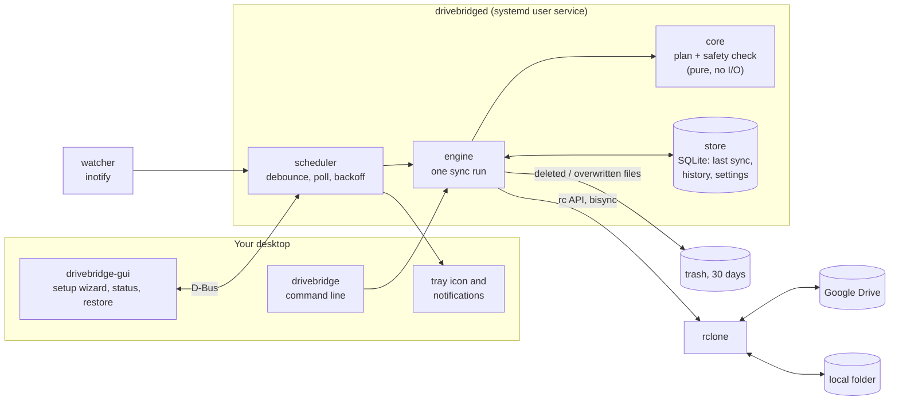

# Drivebridge

[](https://github.com/Rohan708/drivebridge/actions/workflows/ci.yml)
[](LICENSE)

**Two-way Google Drive sync for Linux that is built not to lose your files.**

Drivebridge keeps a folder on your computer and a folder on Google Drive in sync, in both
directions, in the background. It is a Rust service with a GTK4 desktop app; the Drive protocol
work is done by [rclone](https://rclone.org), and Drivebridge adds the part that decides what is
safe to do.

**Status:** pre-alpha. Every safety rule below is covered by tests against a stand-in Drive;
testing against real Google accounts is next.

## Why

Sync tools lose data in a handful of well-known ways: a folder that vanishes while the sync is
stopped looks like "delete everything on the other side"; a network error looks like an empty
Drive; two edits to the same file overwrite each other. Drivebridge treats each of these as a
case to test for, not a bug to fix later.

## Features

- **Two-way sync** of a local folder and a Drive folder, at startup, a few seconds after local
  changes settle, and every five minutes for changes made on Drive
- **Mass-delete guard**: a sync that would delete more than 50 files or 10% of your files stops,
  changes nothing and tells you
- **Conflicts keep both copies**: the newer edit keeps the name, the other is saved beside it as
  `name.conflict1.ext`
- **30-day local trash** for anything a sync deletes or overwrites on your computer, with a
  "Recently removed" list and one-click restore
- **Offline is offline**: if Drive can't be listed, nothing happens; it is never read as
  "everything was deleted"
- **Google Docs, Sheets and Slides** appear as `.desktop` links that open in the browser, and are
  never uploaded back as copies
- **Your own Google key**: you sign in with your own Google Cloud OAuth client, and the token is
  kept in the system keyring, never in a file
- **Desktop integration**: a setup wizard, a status window, a tray icon, and notifications when a
  sync is stopped for safety or a file changed on both sides
- **Command line** for everything: `setup`, `sync --dry-run`, `status`, `pause`, `resume`,
  `restore`

## Screenshots

See [docs/screenshots](docs/screenshots/README.md).

## How it works



Every sync run does the same five steps:

1. **List** both sides through a private `rclone rcd`. If Drive can't be listed, stop.
2. **Plan**: compare local, Drive and the state after the last sync, and decide for each file
   whether to upload, download, delete or keep both. This is a pure function in `crates/core`.
3. **Check** the plan against the safety rules. A plan that deletes too much is not carried out.
4. **Carry it out** with `rclone bisync`, with local deletions going to the trash.
5. **Record** the new agreed state, so the next run knows what changed since.

More detail: [docs/architecture.md](docs/architecture.md).

## Install

### .deb (Ubuntu 24.04 and newer)

Releases include a `.deb` with all three programs, the systemd user unit and the app launcher.
It needs rclone 1.66 or newer, which Ubuntu's own package isn't, so install rclone first:

```sh
curl https://rclone.org/install.sh | sudo bash
sudo apt install ./drivebridge_*.deb
```

### Flatpak

`packaging/flatpak/` has a manifest (GNOME 46 runtime, rclone bundled) and build steps.

### From source

You need Rust 1.89+ (via [rustup](https://rustup.rs)), `pkg-config`, `libdbus-1-dev`,
`libgtk-4-dev`, `libadwaita-1-dev` and rclone 1.66+.

```sh
cargo install --path crates/cli --root ~/.local
cargo install --path crates/daemon --root ~/.local
cargo install --path crates/gui --root ~/.local
mkdir -p ~/.config/systemd/user ~/.local/share/applications
cp packaging/drivebridged.service ~/.config/systemd/user/
cp packaging/io.github.Drivebridge.App.desktop ~/.local/share/applications/
```

## Use it

First create your own Google OAuth client (about ten minutes, once):
[docs/google-setup.md](docs/google-setup.md).

Then open **Drivebridge** from your app menu and follow the wizard, or use the command line:

```sh
drivebridge setup --client-secret ~/Downloads/client_secret_XXXX.json
drivebridge sync --dry-run       # see what the first sync would do
drivebridge sync
drivebridge status
drivebridge restore              # list files removed or overwritten locally
drivebridge restore notes/todo.txt
```

By default `~/GoogleDrive` syncs with a Drive folder named `Drivebridge`; change them with
`--local` and `--drive-folder`. Setup starts the background service, which you can follow with
`journalctl --user -u drivebridged -f`. Set `DRIVEBRIDGE_NO_TRAY=1` to hide the tray icon.

## Safety model

| What happens | What Drivebridge does | Tested by |
| --- | --- | --- |
| Same file edited on both sides | Keeps both; the newer keeps the name | `same_file_edited_on_both_sides_keeps_both` |
| Local folder deleted while the service is stopped | Treated as a mass delete; nothing changes | `local_folder_wiped_while_stopped_is_blocked` |
| Drive unreachable | Treated as offline; nothing changes, retries with backoff | `unreachable_drive_changes_nothing` |
| Drive comes back after an outage | Edits made meanwhile sync normally | `sync_catches_up_after_drive_comes_back` |
| File deleted on Drive | Moved to the local trash, restorable for 30 days | `file_deleted_on_drive_goes_to_local_trash` |
| File deleted locally but edited on Drive | The edit wins; the file comes back | `edit_on_drive_survives_local_delete` |
| Sync killed mid-run | The next run clears the leftover lock and carries on | `lock_left_by_a_killed_run_is_cleared` |
| Sync state lost | Resync restores rather than deletes | `lost_bisync_state_loses_no_files` |
| Two syncs at once | The second doesn't start, and says a sync is running | `only_one_sync_runs_at_a_time` |
| `.git`, `node_modules`, editor temp files | Never synced | `ignored_files_stay_local` |

These run end to end with a real `rclone bisync` between two folders, one standing in for
Drive, in `crates/engine/tests/scenarios.rs`; the planner's rules also have fast unit tests in
`crates/core`.

## Development

```sh
cargo build
cargo test                                          # unit and planner scenario tests
dbus-run-session -- cargo test -- --include-ignored # everything, incl. real rclone and D-Bus
```

| Path | What it is |
| --- | --- |
| `crates/core` | Sync plan and safety rules: pure logic, no I/O |
| `crates/store` | SQLite: settings, the last agreed state, history |
| `crates/rclone` | rclone rc client, `rclone rcd` supervision, bisync runner |
| `crates/engine` | One sync run; settings, keyring, trash, Google Docs links; scenario tests |
| `crates/watcher` | Local change watcher (inotify) |
| `crates/daemon` | `drivebridged`: scheduler, D-Bus interface, tray, notifications |
| `crates/cli` | `drivebridge` command-line tool |
| `crates/gui` | `drivebridge-gui` desktop app (GTK4 + libadwaita) |
| `packaging/` | systemd unit, .desktop, AppStream metainfo, icon, .deb and Flatpak |

See [CONTRIBUTING.md](CONTRIBUTING.md).

## License

GPL-3.0-or-later. See [LICENSE](LICENSE).
